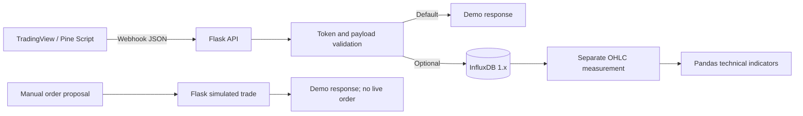

# Python Trading Automation & Backend Development

**Python • Flask • REST APIs • Webhooks • Pandas • InfluxDB • TradingView Pine Script • pytest • GitHub Actions**

A portfolio-focused refactoring of my original **2024–2025 personal trading automation prototype**. It demonstrates building an HTTP backend for external trading alerts, validating structured JSON, calculating technical indicators, and recording events in an optional time-series database. The source also includes historical TradingView Pine Script strategy experiments.

[](https://github.com/dream1004sdf/Auto_Trading_bot_Local_Server_Webhook_With_Script_Projects/actions/workflows/tests.yml)

> **Safety and scope:** This is a local demonstration and software-engineering portfolio, **not a production trading system**. All orders are simulated. Live brokerage authentication/order placement and real account access are intentionally disabled. No profitability or production-readiness claims are made.

## Project overview

| | |
| --- | --- |
| **Problem** | TradingView provides alert events, but downstream validation, persistence, indicator processing and APIs require a separate backend. |
| **My solution** | A Flask-based service that validates webhook requests and optional tokens, separates signal ingestion from OHLC analytics, and offers predictable demo-only order handling. |
| **My role** | Personal project: initial API/webhook and indicator prototype; later portfolio refactoring, input checks, documentation and automated tests. |
| **Outcome** | A runnable localhost demonstration with automated tests. See [test evidence](docs/TESTING.md) for CI results and limitations. |
| **Project timeline** | Initial experiments: 2024–2025; portfolio cleanup: October 2026. |

## Features and engineering decisions

- **Webhook processing:** `POST /webhook` checks input shape, accepts a configured shared token, sanitizes database fields and returns structured JSON.
- **Technical analysis:** Pandas calculations for RSI, Bollinger Bands, ATR and ATR-based upper/lower bands. The latter are **not a complete Supertrend trend-state indicator**.
- **Persistence (optional):** InfluxDB **1.x** records accepted alert events; indicator refresh reads the separately populated `trading_metrics` OHLC measurement.
- **Safe trade simulation:** `POST /trade` validates a buy/sell order proposal and responds without contacting a brokerage.
- **Error handling:** Client validation errors use HTTP 400/401 and unavailable data-service errors use HTTP 503. Flask logs internal database failures without exposing stack traces in the response.
- **Developer workflow:** pytest-based tests and GitHub Actions CI on Linux and Windows with multiple Python versions.

## Architecture



For endpoint behavior, code walkthrough and design trade-offs, see **[Source code walkthrough](docs/CODE_WALKTHROUGH.md)**.

## API endpoints

| Method | Endpoint | Behavior |
| --- | --- | --- |
| GET | `/health` | Reports demo configuration |
| POST | `/webhook` | Validates alert JSON; optionally writes filtered fields to InfluxDB |
| POST | `/trade` | Simulates a limit-order proposal, without submitting anything |
| GET | `/wallet` | Intentionally disabled (HTTP 501) |
| GET | `/update_strategies` | Refreshes indicators from separately populated InfluxDB OHLC records |

## Run on Windows (PowerShell)

**Convenience setup:** Review [`scripts/setup_windows.ps1`](scripts/setup_windows.ps1) and run `powershell -ExecutionPolicy Bypass -File .\\scripts\\setup_windows.ps1` from the repository folder. The script selects an installed Python 3.12 or 3.11 interpreter, creates a project-only `.venv`, installs Flask and other dependencies, reports versions and runs tests. It does not change the system-wide Python environment. **You must run this on your own PC; GitHub cannot install software onto your computer.**

**Manual setup:** Use an isolated Python virtual environment. The project is **verified on Python 3.11** in CI; see the [CI matrix](docs/TESTING.md) for any additional verified versions.

```powershell
py -0p                           # List installed Python interpreters
py -3.11 -m venv .venv           # Or replace 3.11 with a verified installed version
.\.venv\Scripts\python.exe -m pip install --upgrade pip
.\.venv\Scripts\python.exe -m pip install -r requirements.txt
.\.venv\Scripts\python.exe -m pytest -q
.\.venv\Scripts\python.exe Server.py
```

Visit **http://127.0.0.1:5000/health**. You do not need Coinbase credentials or InfluxDB to use the default demo.

```powershell
Invoke-RestMethod http://127.0.0.1:5000/health
Invoke-RestMethod -Method Post -Uri http://127.0.0.1:5000/webhook -ContentType "application/json" -Body '{"symbol":"BTC-USD","action":"buy"}'
Invoke-RestMethod -Method Post -Uri http://127.0.0.1:5000/trade -ContentType "application/json" -Body '{"side":"buy","product_id":"BTC-USD","size":0.01,"price":50000}'
```

**macOS/Linux:** create a `python3 -m venv .venv` environment, activate it and run `python -m pip install -r requirements.txt`, `python -m pytest -q`, `python Server.py`.

## Configuration

`.env.example` lists available variables. It is a **template only**, and Python does **not** automatically read it. Supply configuration through your shell or process manager. For a local demo, `INFLUXDB_ENABLED=false` and loopback binding are defaults.

For optional remote alert receipt, set `WEBHOOK_TOKEN` to a strong secret and deploy behind an authenticated HTTPS reverse proxy, with appropriate rate limiting and other protections. The Flask development server is **not** a production web server.

```powershell
$env:WEBHOOK_TOKEN = "replace_with_your_own_random_secret"
$env:INFLUXDB_ENABLED = "false"
.\.venv\Scripts\python.exe Server.py
```

Send the secret in `X-Webhook-Token` or as the JSON `token` key. Do not commit real credentials. For InfluxDB 1.x, set `INFLUXDB_ENABLED=true` and the `INFLUXDB_HOST`, `INFLUXDB_PORT`, `INFLUXDB_DATABASE` variables. OHLC records must be loaded independently into `trading_metrics` (`time`, `high`, `low`, `close`); the webhook route does not construct candles.

## Tests and evidence

- `python -m pytest -q` runs HTTP, authorization, data validation, indicator math and **mocked** InfluxDB failure/success-path checks.
- GitHub Actions installs the dependencies and tests on Windows and Linux runners.
- Review recorded run IDs, exact results and **untested areas** in [docs/TESTING.md](docs/TESTING.md). GitHub badges indicate current workflow status, not guaranteed live brokerage connectivity.

## Historical Pine Script research

Five `.pinescript` files cover strategy ideas involving EMA crosses, RSI, Bollinger Bands, reversals, volatility and Supertrend variations. Some experiments target different exchanges and versions. These are preserved as **historical research artifacts** and are not represented as verified live strategies or a profitable backtest. No original Pine Script performance claims are made.

## Limitations, safety and transparency

1. Exchange auth and live orders are **not** supported. `/wallet` explicitly returns 501.
2. Real InfluxDB server integration, historical Pine Script compilation and end-to-end TradingView connectivity are **not fully validated** by mocked unit tests.
3. Webhook authentication is optional to ease localhost experimentation. **Do not** expose the development server publicly without appropriate security hardening.
4. Removing old credentials from the latest files **does not scrub Git history**. See [SECURITY.md](SECURITY.md) for the identified historical exposure risk and instructions to rotate credentials or publish a clean-history copy before sharing this project as a portfolio.
5. `/update_strategies` is retained as a legacy GET endpoint despite its persistence side effect; it should become POST in a future version.

## Recruiter notes

For a concise project summary and accurate, source-backed resume bullet options, see [docs/RESUME_NOTES.md](docs/RESUME_NOTES.md). These descriptions distinguish **implemented features** from **planned or unverified integrations**.
